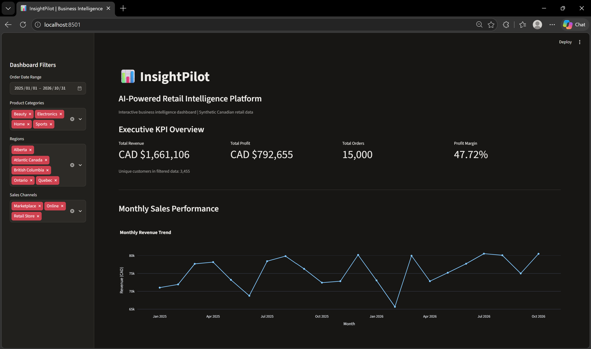
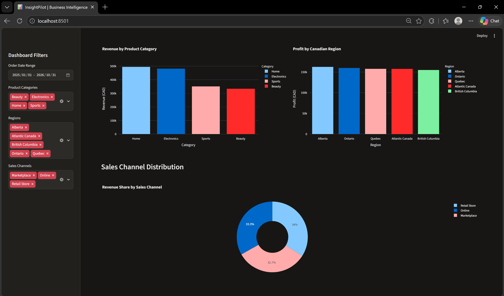
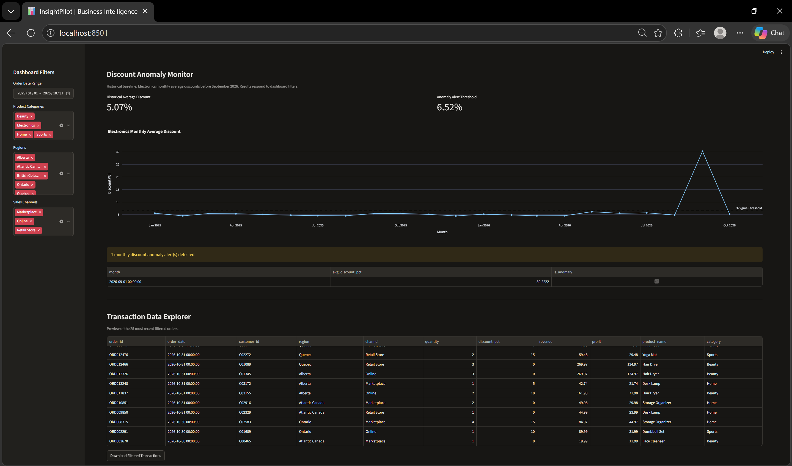
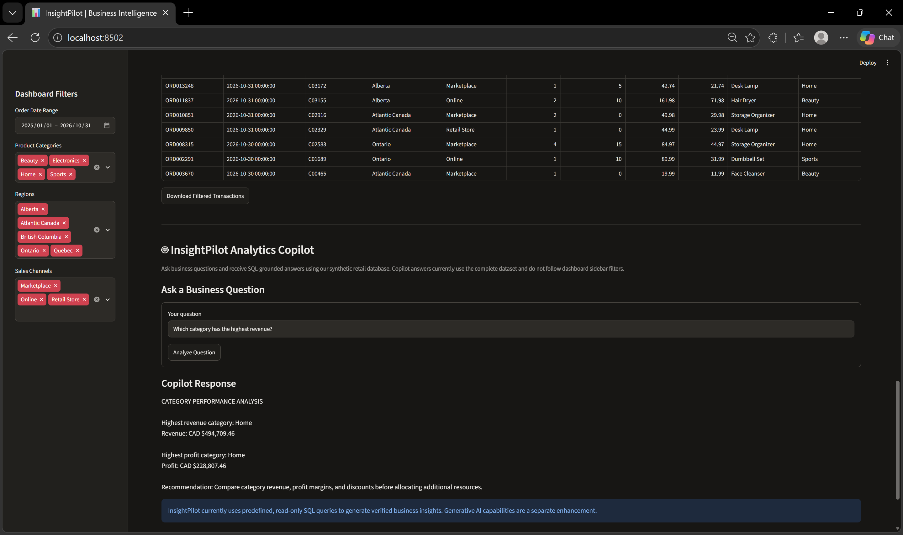

# InsightPilot

### SQL-Grounded Retail Intelligence & Analytics Copilot

InsightPilot is an interactive business intelligence application
built with Python, DuckDB, Streamlit, and Plotly.

It transforms synthetic Canadian retail transaction data into
interactive dashboards, profitability analysis, statistical
discount alerts, and SQL-grounded business question answering.

## Project Overview

The application analyzes 15,000 synthetic retail orders across
16 products, four product categories, five Canadian regions,
and three sales channels.

The dataset covers January 2025 through October 2026.

InsightPilot demonstrates an integrated workflow from data
generation and SQL processing to visual analytics, automated
insights, and application testing.

## Dataset Snapshot

| Metric | Value |
|---|---:|
| Synthetic orders | 15,000 |
| Synthetic products | 16 |
| Unique simulated customers | 3,455 |
| Total simulated revenue | CAD $1,661,105.99 |
| Total simulated profit | CAD $792,654.99 |
| Profit margin | 47.72% |

These totals are generated from a fixed random seed (42) and are not real company results.

## Key Features

### 1. Executive KPI Dashboard

- Total revenue and profit
- Total orders
- Profit margin
- Unique customer counts
- Interactive filtering by date, category, region, and channel

### 2. Business Performance Analysis

- Monthly revenue trends
- Product category performance
- Regional sales and profitability
- Sales channel distribution
- Transaction-level data exploration
- Downloadable filtered transaction data

### 3. Discount Anomaly Monitoring

The application analyzes monthly Electronics discounts
against a historical baseline.

A three-standard-deviation threshold is used to identify
unusually high average discount values.

September 2026 contains an intentionally simulated
promotional discount anomaly.

Statistical alerts are analytical signals, not evidence
of fraud or wrongdoing.

### 4. Analytics Copilot

The SQL-grounded Copilot supports questions about:

- Overall revenue, profit, and order volume
- Highest-performing product categories
- Regional profitability
- Sales channel performance
- Month-over-month revenue changes
- Electronics discount anomalies

The Copilot uses predefined, read-only SQL queries and
question-pattern matching. Despite the dashboard's illustrative
"AI-Powered" title, this version **does not use an LLM or generative AI**.

It does not currently use a generative language model,
and its responses cover the complete dataset independently
of the dashboard's sidebar filters.

### 5. Automated Validation

The project includes automated regression tests for
expected KPI values, Copilot responses, and unsupported
or empty questions.

A separate privacy-audit utility scans text files for
selected potential sensitive-information patterns.

## Technology Stack

| Technology | Purpose |
|---|---|
| Python | Data processing and application logic |
| DuckDB | SQL analytics database |
| Pandas | Data transformations and aggregation |
| Streamlit | Interactive web application |
| Plotly | Data visualization |
| unittest | Automated Copilot validation |

## Project Structure

```text
InsightPilot/
├── data/
│   ├── orders.csv
│   └── products.csv
├── reports/
├── screenshots/
├── src/
│   ├── generate_data.py
│   ├── 01_build_database.py
│   ├── 02_category_analysis.py
│   ├── 03_regional_analysis.py
│   ├── 04_anomaly_detection.py
│   ├── 05_privacy_audit.py
│   └── copilot_engine.py
├── tests/
│   └── validate_copilot.py
├── app.py
├── setup_project.py
├── requirements.txt
├── .gitignore
└── README.md
```

Generated database files, virtual environments, and
temporary Python files are excluded from version control.

## Getting Started

### Prerequisites

- Python 3.12
- Windows, macOS, or Linux
- A modern web browser

### 1. Install dependencies

Use Python **3.12**. From the project root, run:

```bash
python -m pip install -r requirements.txt
```

A virtual environment is recommended. If you use VS Code, select the
Python 3.12 interpreter and run `setup_project.py` with the Run button to
create `.venv` and install the dependencies. Then select the newly created
`.venv` interpreter in VS Code before running other project scripts.

If working from a terminal, activate your Python 3.12 virtual environment
before using the commands below.

### 2. Generate synthetic data

```bash
python src/generate_data.py
```

This creates `orders.csv` and `products.csv`.

### 3. Build the SQL database

```bash
python src/01_build_database.py
```

The script creates the local DuckDB database and performs
initial data-integrity checks.

### 4. Run the analytics scripts

```bash
python src/02_category_analysis.py
python src/03_regional_analysis.py
python src/04_anomaly_detection.py
```

The generated analytical reports are saved in `reports/`.

### 5. Launch InsightPilot

```bash
python -m streamlit run app.py
```

Open the local address displayed in the terminal,
typically http://localhost:8501.

### 6. Run automated validation

```bash
python tests/validate_copilot.py
```

### 7. Run the privacy audit

```bash
python src/05_privacy_audit.py
```

Inspect the generated report and manually review
screenshots and files before publishing.

## Dashboard Preview

**Executive KPI overview and monthly revenue trends**



**Category, regional, and channel performance**



**Electronics discount anomaly monitor**



**SQL-grounded question answering**



## Evidence Screenshots

All 12 screenshots are included in the [`screenshots/`](screenshots/) folder:

| # | Evidence |
|---|---|
| 01 | [SQL database validation](screenshots/01_sql_database_validation.png) |
| 02 | [Category performance](screenshots/02_category_performance.png) |
| 03 | [Regional performance](screenshots/03_regional_performance.png) |
| 04 | [Discount anomaly detection](screenshots/04_discount_anomaly_detection.png) |
| 05 | [Executive dashboard](screenshots/05_interactive_dashboard.png) |
| 06 | [Business performance charts](screenshots/06_business_performance_dashboard.png) |
| 07 | [Anomaly monitor](screenshots/07_anomaly_monitor_dashboard.png) |
| 08 | [Interactive region filtering](screenshots/08_interactive_filter_validation.png) |
| 09 | [Copilot engine test](screenshots/09_copilot_engine_test.png) |
| 10 | [Copilot in the dashboard](screenshots/10_interactive_copilot.png) |
| 11 | [Regional Copilot response](screenshots/11_copilot_regional_profitability.png) |
| 12 | [Nine automated test results](screenshots/12_automated_copilot_tests.png) |

## Data Notes

All business records are synthetically generated.

Customer IDs, sales, profits, discounts, products,
and regions are simulated for demonstration purposes.

The data does not represent actual customers,
business transactions, or company performance.

The intentionally introduced anomaly is designed
to demonstrate analytical detection and interpretation.

## Limitations

- The Copilot supports predefined question types.
- Copilot results do not currently inherit dashboard filters.
- Synthetic patterns should not be treated as real-world evidence.
- The application runs locally and is not a deployed service.
- Generative AI and retrieval-augmented generation are not
  implemented in the current version.

## Future Enhancements

- Optional LLM-generated explanations grounded in SQL results
- Filter-aware Copilot responses
- Additional business questions and conversational context
- Downloadable executive PDF reports
- Cloud deployment and authentication
